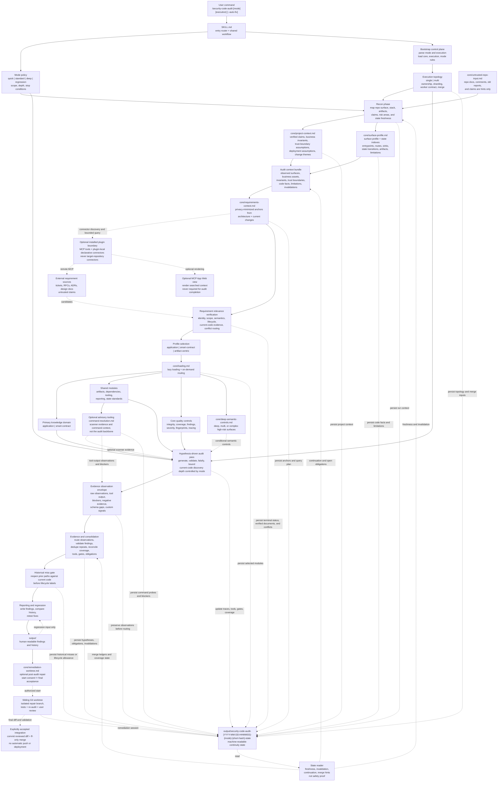

# security-code-audit Architecture and Feature Guide

This document explains the architecture, design logic, and maintenance invariants of `security-code-audit`.

This is an internal maintainer document. The delivered runtime surface is `SKILL.md` plus subdirectories; any rule required during an audit must also live in the delivered runtime files, not only here.

Its purpose is stability:
- reduce future structure drift
- keep module boundaries clear
- preserve lazy-loading and on-demand loading behavior
- make it obvious where new content belongs

If implementation details and this document disagree, prefer:
1. `SKILL.md`
2. `VERSIONING.md`
3. `ARCHITECTURE.md`
4. `README-AI.md`

---

## System Flow Overview

This diagram is a maintainer map, not the only workflow source of truth. Runtime behavior must remain encoded in `SKILL.md` and the delivered subdirectory files.

`State reader` is a conceptual operation: read prior state, summarize freshness / invalidation, continuation / open obligations, and coverage / merge hints, then use those hints without treating them as proof. It is not a new runtime file, schema, service, or platform component.

---

## Design Goals

`security-code-audit` is designed around seven goals:

1. Stable audit behavior
   The same class of repo should trigger the same scan path, module routing, and report shape.

2. Low context bloat
   The skill should not bulk-load its whole knowledge tree. It should load only what the current phase and observed surface require.

3. Precision retention under scale or complexity
   The skill should preserve a compact run context for every audit, and richer detail for large, long-running, or high-complexity audits, so context compression does not silently erase important scan state.

4. Clear responsibility boundaries
   Execution control, quality controls, mode depth, and reference knowledge must stay separated.

5. Extensible coverage
  New languages, artifacts, vulnerabilities, ecosystems, and playbooks should be addable without rewriting the whole skill.

6. Low drift maintenance
  New modules should be discoverable from indexes and loadable from routing rules without hidden one-off behavior.

7. Domain-correct audit behavior
  Traditional web/API audits and smart-contract audits should not be forced through the same knowledge spine once recon identifies the target type.

---

## Layer Model

The skill is intentionally split into layers with different responsibilities.

### 1. Router Layer

File:
- `SKILL.md`

Purpose:
- parse mode and execution arguments
- define shared workflow and report template
- define mandatory audit behavior
- point to the right submodules

Rule:
- `SKILL.md` is the orchestration layer, not the place for deep reference content.

### 2. Quality-Control Layer

Directory:
- `core/`

Purpose:
- prevent hallucination, evidence drift, and false positives
- enforce coverage and consistent findings
- drive lazy-loading and on-demand loading
- own tracing methodology that should not drift into domain-reference files or audit-state storage rules

Important files:
- `core/loading.md`
- `core/untrusted-repo-input.md`
- `core/surface-profile.md`
- `core/project-context.md`
- `core/remediation-worktree.md`
- `core/bidirectional-tracing.md`
- `core/deep-semantic-controls.md`
- `core/integrity.md`
- `core/coverage.md`
- `core/findings.md`
- `core/execution-safety.md`
- `core/fingerprints.md`
- `core/severity.md`

Rule:
- `core/` controls audit quality, not domain knowledge.
- post-audit remediation remains outside the six-stage audit result: it may repair
  accepted findings only after reporting, in an isolated worktree, with separate
  final commit/merge acceptance.

### 3. Execution Layer

Directory:
- `execution/`

Purpose:
- define topology, not scan depth
- separate `single` from beta `multi`
- keep worker roles, handoff contracts, coverage critics, independent verifiers,
  sharding, and merge behavior explicit

Rule:
- execution answers "how agents are arranged and independently checked", not
  "how deep the audit is".

### 4. Profile Layer

Directory:
- `profiles/`

Purpose:
- define target semantics after recon
- decide how stages `3/6` to `5/6` should be described
- decide which audit methodology is primary after recon so contract or artifact-heavy repos do not get forced into an application-security narrative
- separate application, smart-contract, and artifact-centric audit shapes

Rule:
- profiles answer "what kind of target is this", not "how deep is the audit".

### 5. Domain Layer

Directory:
- `references/application/`
- `references/smart-contract/`

Purpose:
- choose which knowledge corpus becomes primary after recon
- keep traditional application-security methodology separate from contract-native methodology
- let `artifact-centric` reuse the application domain without collapsing into contract or web-only assumptions

Rule:
- domains answer "which knowledge family should drive this audit", not "how visible progress should be worded".

### 6. Mode Layer

Directory:
- `modes/`

Purpose:
- define depth and stop conditions
- separate `quick`, `standard`, `deep`, and `regression`

Rule:
- modes answer "how much work to do", not "which knowledge files exist".

### 7. Knowledge Layer

Directory:
- `references/`

Purpose:
- hold audit knowledge, examples, methodology, and reporting standards

Subdirectories:
- `shared/`
- `application/`
- `smart-contract/`

Rule:
- `references/` contains reusable knowledge only. It should not secretly control the top-level workflow.

### Code Audit Plugin Boundary

Directory:
- `plugins/`

Purpose:
- define the security-code-audit-owned extension contract independently of provider names
- let each `plugins/<id>/` declare capabilities, lifecycle, MCP/Skill/Web entrypoints, and declarative configuration
- validate trusted bundled plugin metadata without discovering or executing target-repository plugins

Standard surfaces:
- `plugins/<id>/plugin.json`: Code Audit identity, capability, entrypoint, config, and lifecycle manifest
- `plugins/<id>/.codex-plugin/plugin.json`: optional native Codex installation wrapper for MCP-backed plugins
- `plugins/<id>/.mcp.json`: optional native MCP entry
- `plugins/<id>/skills/*/SKILL.md`: optional native Skill entries
- `plugins/<id>/web/*`: optional MCP Apps sources served through `ui://` resources
- `plugins/<id>/plugin.json.report`: required report presentation; heading, guide, and optional state-local context/rows/review artifacts with summary and table columns
- `tools/audit_plugin_check.py`: fixed-root, metadata-only registry validator
- `tools/plugin_report_render.py`: renders one independent report section per plugin that ran; `report_gate_check.py` enforces section presence and row counts

Boundary rules:
- the audit core remains complete when the plugin is absent or a connector fails
- the core selects plugins by validated capability and lifecycle, not provider-specific names
- only installed plugin-local entrypoints and declarative configs may be used; repository-under-audit plugins are untrusted input and are never executed
- credentials enter only through connector-declared environment variables and never enter prompts, tool arguments, UI state, audit state, logs, or reports
- connector scores prioritize candidates; current code and architecture evidence determine applicability

Distribution boundary:
- the public distribution includes the generic plugin contract and validator
- optional provider implementations may be bundled in the internal distribution
- no provider is required for a complete code-audit runtime

---

## Reference Taxonomy

This split is deliberate and should be preserved.

### `references/application/languages/`

Use for programming-language-specific sinks and grep starters.

Examples:
- Python
- JavaScript
- Go

Do not put:
- Markdown
- OpenAPI
- notebooks
- prompt files

### `references/application/`

Use for the traditional web/API application-security domain router.

This layer answers:
- when application knowledge is the primary audit spine
- how app-layer category guidance should be entered
- how framework, artifact, and vulnerability modules support an application audit

### `references/smart-contract/`

Use for contract-native methodology that should not be flattened into a web Top 10 model.

This layer answers:
- how to review trust, privilege, external calls, accounting, signatures, oracle abuse, and upgradeability
- which contract-specific deep dives should load first
- how to frame attacker profit paths and economic abuse

### `references/smart-contract/languages/`

Use for contract-language-specific grep starters and sink families.

Examples:
- Solidity

### `references/shared/`

Use for modules shared by both the application and smart-contract domains.

This layer answers:
- which artifact, dependency, and reporting modules can be reused across domains
- how to keep common support knowledge out of the domain trees
- how report and state directories share one ignore/bootstrap flow without forcing tool-specific ignore files into every repo
- how machine-readable audit state can store trace checkpoints, bounded function chains, hypotheses, and agent logs without replacing fresh recon or owning the tracing method
- how durable deep semantic gates, dependency semantics, design/implementation conflicts, and proof obligations survive context compression without flattening specialist vulnerability detail
- how optional external tool and repo-script command resolution is handled consistently without hard-coding stale scanner flags
- how state-worthy smart-contract complexity can require richer audit state even when the repo is small

### `output/security-code-audit-{YYYY-MM-DD-HHMMSS}-{mode}-{short-hash}-state/`

Use for machine-readable audit state, not final findings.

This layer answers:
- what the current run knows about routes, controls, source families, sinks, trace checkpoints, function chains, coverage, and hypotheses
- what the current run observed as advisory audit state inventory/index facts, including entrypoints, routes, candidate sources, candidate sinks, state transitions, artifact surfaces, and known limitations
- how raw AI observations, tool output, blockers, negative evidence, and unknown-shaped signals are preserved before they are promoted, rejected, or routed to coverage debt
- what deep semantic gates know about high-risk surfaces, dependency behavior, design/implementation conflicts, semantic assumptions, proof obligations, negative evidence, and coverage debt
- what changed enough to justify aggressive re-audit
- how to restore scan context during large, long-running, or high-complexity reviews
- how Deep or beta `multi` reports can preserve material unresolved hypotheses without overstating them as findings

The state layer stores outputs of tracing.
It does not own the tracing method itself; that stays in `core/bidirectional-tracing.md`.

The state layer stores advisory state inventory and index records.
They are compact repo maps for orientation and selective loading, not a full static-analysis engine and not proof that unlisted code, dynamic routes, generated code, reflection, framework magic, or artifact behavior is absent.

The state layer stores a flexible evidence envelope.
It preserves observations losslessly enough for merge, regression, and later evaluation, but it does not promote observations into confirmed findings by itself.

The state layer also stores durable deep semantic checkpoints.
It does not own the vulnerability-specific detail itself; that stays in the active specialist reference modules and is coordinated by `core/deep-semantic-controls.md`.

It must not be treated as proof that unchanged code is safe.

Project context in state stores verifiable claims, business invariants, trust-boundary assumptions, git change themes, and context conflicts. It must not treat repo-authored prose or commit messages as safety proof.

Tool invocation state stores compact command-resolution evidence, executed scanner commands, blockers, skipped unsafe scripts, and manual fallbacks. It must not store large raw scanner output.

Evidence observations may point to compact tool-output summaries, raw-observation notes, candidate labels, trace links, blockers, or schema gaps. Labels are open-ended, `custom:*` values are allowed, and schema gaps should survive as audit signals instead of being dropped.

### `references/application/frameworks/`

Use for framework-specific trust boundaries and dangerous helpers.

Naming rule:
- `language_framework.md`

Examples:
- `python_flask.md`
- `javascript_express.md`

### `references/shared/artifacts/`

Use for non-language assets that still shape attack surface, trust, rendering, or instruction flow.

Examples:
- markdown
- skill and prompt files
- API specs and collections
- notebooks

Why this exists:
- these assets are not programming languages
- they are not vulnerability classes by themselves
- they are audit surfaces that can reveal or create risk

Current consolidation rule:
- skill, agent, and instruction-bearing repository review stays consolidated in `references/shared/artifacts/skill-files.md`
- do not split a separate skill-risk artifact leaf until scope, routing needs, and coverage needs clearly justify a second module
- revisit splitting only when the combined module becomes materially harder to route, maintain, or reason about

### `references/application/vulnerabilities/`

Use for weakness methodology.

Examples:
- authentication
- authorization
- prompt injection

This layer answers:
- what the weakness is
- how to audit for it
- what safe patterns look like

### `references/shared/dependencies/`

Use for ecosystem-specific dependency review and SCA routing.

This layer answers:
- how to audit package risk for a given ecosystem
- which native tools to run
- how to merge future SCA output

### `references/application/exploits/`

Use for verification playbooks after a finding is verified or strongly suspected.

This layer answers:
- how to prove the issue safely
- what subtype to test
- what success indicators matter

### `references/shared/reporting/`

Use for report shape, severity, remediation, coverage, history, and statistics rules.

This layer answers:
- how to write the final output consistently

---

## Request Flow

The top-level request path should stay stable.

### 1. Entry

`SKILL.md` parses:
- help path
- mode
- execution mode

Help is an early-exit path.
It should not initialize a scan plan or load deep reference trees.

### 2. Bootstrap

Always start with:
- `core/index.md`
- `core/loading.md`
- `execution/index.md`
- one execution file
- `modes/index.md`
- one mode file

Do not bulk-load everything else at bootstrap.

### 3. Recon

Recon should:
- identify language and framework
- inventory code, config, templates, artifacts, and manifests
- build one compact surface profile
- choose one target profile
- choose one primary knowledge domain

Recon is not just file counting. It exists to decide what to load later.

### 4. Choose Profile

After recon and before stage `3/6`, select exactly one target profile.

Examples:
- Solidity-heavy repo -> `profiles/smart-contract.md`
- prompt / markdown / notebook-heavy repo -> `profiles/artifact-centric.md`
- ordinary backend or web app -> `profiles/application.md`

### 5. Choose Domain

After choosing the profile, select exactly one primary knowledge domain.

Examples:
- `profiles/smart-contract.md` -> `references/smart-contract/index.md`
- `profiles/application.md` -> `references/application/index.md`
- `profiles/artifact-centric.md` -> `references/application/index.md`

### 6. Route By Surface

After recon, later loading should be driven by the observed surface profile.

Examples:
- markdown renderer -> `references/shared/artifacts/markdown.md`
- `.ipynb` -> `references/shared/artifacts/notebooks.md`
- OpenAPI/Postman -> `references/shared/artifacts/api-specs.md`
- `.sol` -> `references/smart-contract/languages/solidity.md` plus smart-contract modules
- optional external scanner or repo-defined audit command -> `references/shared/tooling/command-resolution.md`

### 7. Scan

Phase 2 uses:
- the active domain as the primary audit spine
- selected specialist modules
- dependency modules when manifests or SCA artifacts exist

### 7. Verify

Only after a finding is verified or strongly suspected:
- load `references/application/exploits/index.md` for application findings
- load `references/smart-contract/exploits/index.md` for contract findings
- then load the exact playbook needed

### 8. Report

Late in the run:
- load `references/shared/reporting/index.md`
- use history, severity, remediation, coverage, and output standards

---

## Lazy-Loading Principles

Lazy-loading is a core architectural choice, not an optimization afterthought.

### Core Rules

1. Never load all indexes and all leaf files together.
2. Prefer one routing file plus one or two leaf files.
3. Use recon output to justify every deeper load.
4. Re-load only when phase or decision context changes materially.
5. Keep history, reporting, and severity out of early recon unless directly needed.

### Why It Matters

Without lazy-loading:
- context gets bloated
- instructions compress each other
- important constraints drift
- scan quality becomes less predictable

### Canonical Router

`core/loading.md` is the canonical lazy-loading router.

If a new module is added and the skill is supposed to load it automatically:
- update the relevant leaf index
- update `references/index.md` if top-level discoverability changed
- update `core/loading.md` if routing behavior changed

---

## Surface Profile Model

The surface profile is the central contract between recon and later phases.

Its job is to compress the repo into a small routing summary such as:
- languages
- frameworks
- auth/token presence
- API versions
- template engines
- markdown rendering
- prompt or skill files
- API specs and collections
- notebook artifacts
- upload/download flows
- dependency ecosystems
- IaC/config surfaces
- smart-contract surfaces

Rule:
- later phases should prefer reusing the surface profile over repeating broad recon.

---

## Feature Model

The skill currently supports these major feature classes.

### Audit Features

- full-category application audit
- dependency review by ecosystem
- artifact review for non-code assets
- exploit verification playbooks
- historical comparison and regression retest

### Control Features

- hallucination prevention
- repo-input distrust
- fingerprint-based dedupe
- coverage discipline
- severity normalization

### Execution Features

- `single` execution
- beta `multi` execution
- depth modes: `quick`, `standard`, `deep`, `regression`

### Reporting Features

- terminal summary
- history files
- regression retest files
- timestamped reports
- minimal-fix and hardening split

---

## Boundary Rules

These are the most important anti-drift rules.

### Rule 1: `SKILL.md` is a controller

Do not move large reference content into `SKILL.md`.
It should route, not become a giant encyclopedia.

### Rule 2: `core/` is for quality, not domain detail

Do not move language or vulnerability guidance into `core/`.

### Rule 3: `profiles/`, domains, `modes/`, and `execution/` are different axes

- `profiles/` = target semantics
- domains = primary knowledge family
- `modes/` = depth
- `execution/` = topology

Do not mix them.

### Rule 4: `artifacts/` is for asset types, not weaknesses

Examples:
- markdown
- API specs
- notebooks
- prompt files

Do not move weakness methodology there.

### Rule 5: `vulnerabilities/` is for methodology, not recon assets

Examples:
- `api-security.md` explains runtime API weaknesses
- `references/shared/artifacts/api-specs.md` explains how specs and collections reveal hidden surface

These can overlap in topic, but not in role.

### Rule 6: `exploits/` is downstream of findings

Do not use exploit playbooks as the primary routing layer for broad audit coverage.

### Rule 7: every new leaf should have two paths

For any new reference file that matters operationally:
- one discovery path from an index
- one routing path from `core/loading.md` or explicit `SKILL.md` logic if it is automatically loaded

### Rule 8: internal docs are not runtime dependencies

The delivered root runtime file is `SKILL.md`; root-level README, architecture, AI-maintainer, and versioning documents are internal development material.
Do not make audit execution, help output, report generation, mode semantics, or loading decisions depend on root-level internal docs.

---

## Extension Patterns

### Adding a language

Add:
- `references/application/languages/<language>.md`
- `references/application/languages/index.md`

If it introduces a new domain such as contracts, also consider:
- vulnerability module
- exploit playbook
- framework modules if appropriate

### Adding an artifact type

Add:
- `references/shared/artifacts/<artifact>.md`
- `references/shared/artifacts/index.md`
- `references/index.md`

If it changes routing:
- update `core/loading.md`
- update recon wording in `SKILL.md` if needed

### Adding a vulnerability module

Add:
- `references/application/vulnerabilities/<topic>.md`
- `references/application/vulnerabilities/index.md`

If the module is part of default routing:
- update `SKILL.md`
- update `core/loading.md`

### Adding an exploit playbook

Add:
- `references/application/exploits/<topic>.md`
- `references/application/exploits/index.md`

Do not treat this as a default recon module.

---

## Common Failure Modes

These are the patterns future maintainers should avoid.

- putting new deep content directly into `SKILL.md`
- adding a new reference file without updating its index
- adding a new surface without updating `core/loading.md`
- treating `artifacts/` like a dumping ground for config or dependencies
- duplicating the same logic in README, README-CN, and SKILL
- using `exploits/` as a substitute for vulnerability methodology
- making help output depend on README files that are not part of the delivered runtime surface

---

## Maintenance Checklist

Before closing a change, verify:

1. the new file is in the right layer
2. the right index references it
3. `core/loading.md` knows how to route to it if needed
4. `SKILL.md` only changed if workflow or routing really changed
5. versioning still matches `VERSIONING.md`
6. internal README files stayed short
7. delivered runtime rules live in `SKILL.md` or subdirectory files, not only in root-level internal docs
8. the architecture still preserves lazy-loading and surface-driven routing

---

## Practical Summary

If you need a short mental model, use this:

- `SKILL.md` decides the path
- `core/` protects result quality
- `execution/` decides agent topology
- domains decide the primary knowledge spine
- `modes/` decide audit depth
- deep semantic gates preserve high-risk reasoning state
- `references/` provide knowledge
- recon builds a surface profile
- `core/loading.md` routes by surface
- reporting is loaded late

That model should remain true over time.
