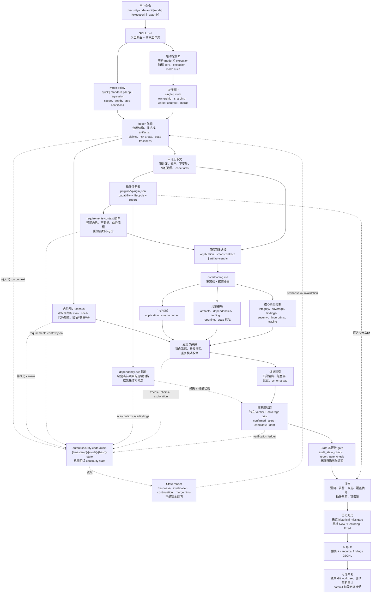

# Security Code Audit

`security-code-audit` 用来检查代码仓库里的安全风险，适用于 Web/API、后端、全栈应用、配置与依赖、代码型文档 artifact，以及 Solidity 智能合约。

当前版本：`4.3.0`

## 意义

代码仓库里的安全问题不一定会直接出现在一个明显的危险函数里。真实风险经常藏在路由、鉴权、数据流、配置、依赖、部署假设、业务流程、价格/额度计算、文件处理、模板渲染、prompt/markdown artifact 或智能合约状态变化之间。

普通搜索或浅层 pattern matching 很容易只找到单点命中，漏掉完整攻击链、重复出现的问题、历史修复回归，或者把没有证据的猜测写成 finding。

这个 Skill 的作用是把代码安全审计整理成一套可重复的流程，帮助你判断：

- 代码里有没有真实可利用的鉴权、注入、SSRF、XSS、路径穿越、反序列化、文件上传下载、数据泄露或业务逻辑问题
- 依赖、配置、CI、API spec、notebook、markdown/prompt artifact 是否引入额外风险
- 智能合约里有没有重入、权限、升级、签名、预言机、精度、会计或状态机问题
- source/sink、source/state、信任边界和部署假设是否能闭环证明
- LLM 是否能沿着新发现的调用者、兄弟 helper 和外部集成继续探索，并把分支与反证留下可审计记录
- 智能合约的角色权限是否真正约束到 token、spender、recipient、route、amount、结算语义和状态键
- 修复是否真的挡住原攻击路径，而不是只改掉表面现象
- 哪些审计面已经覆盖，哪些只是 partial、blocked、time-boxed 或需要后续补证

## 目标

这个 Skill 不承诺证明“绝对安全”。它的目标是：

1. 扫描当前仓库的代码、依赖、配置、文档 artifact、API 面和智能合约面。
2. 按目标类型选择 application、smart-contract 或 artifact-centric 审计语义。
3. 用 `quick`、`standard`、`deep` 或 `regression` 模式控制审计深度。
4. 优先产出有证据、有位置、有攻击路径、有最小修复建议的 confirmed findings。
5. 把未证实但高价值的信号、假设、阻塞点和覆盖债务保留下来，而不是静默丢弃。
6. 输出一份人类可读报告，并维护本地 audit state，方便后续增量审计和回归验证。
7. 在架构和代码变更识别完成后，通过可信 connector 查找对应需求，并验证需求声明和当前实现是否一致。

默认报告会写到运行目录（一般就是被审计项目目录）的 `output/` 子目录：

```text
<运行目录>/output/security-code-audit-<timestamp>-<mode>-<short-hash>.md
<运行目录>/output/security-code-audit-<timestamp>-<mode>-<short-hash>-findings.jsonl
<运行目录>/output/security-code-audit-<timestamp>-<mode>-<short-hash>-state/
```

报告、canonical findings JSONL 和 state bundle 都放在运行目录的 `output/` 下，并且文件名包含 `security-code-audit-` 前缀、真实本地时间戳和短 hash，避免和 `output/` 里的其他报告混在一起，也避免多次运行互相覆盖。`output/` 是审计产物目录，不应当被当作被审计项目自身的业务代码。

- 新 coverage 单元可使用 `coverage_id` 与 `canonical_refs` 建立跨 agent、跨运行的稳定身份；状态 gate 会校验 ID 与维度是否一致。
- 需要执行目标代码时必须满足无外网、清空环境、目标只读、scratch-only 写入和资源限制；否则保留为需要验证的证据，不把失败执行当成安全证明。
- `standard`/`deep` 的确认漏洞要经过独立 verifier；多 agent 运行还要在每轮 hunting 后经过 coverage critic。

## 使用步骤

### 在Agent里使用

审计当前项目，直接说：

```text
/security-code-audit
```

这等价于 `deep single`，会做高保证当前代码发现、攻击链追踪和语义闭环。

如果只想快速看高风险变更：

```text
/security-code-audit quick
```

如果要做更深的语义审计：

```text
/security-code-audit deep
```

如果要验证最近报告里的修复是否真的生效：

```text
/security-code-audit regression
```

查看帮助：

```text
/security-code-audit help
```

审计完成后，默认会询问是否需要自动修复。若希望在启动时就允许准备修复，使用：

```text
/security-code-audit deep --auto-fix
```

`--auto-fix` 只跳过“是否开始修复”的首次询问。它会在独立 Git worktree 和修复分支中修改、测试并重新验证，然后把最终 diff、测试结果、剩余风险和建议 commit message 交给用户阅览。只有用户阅览后明确接受，才会创建 commit，并用 `git merge --ff-only` 合并回审计开始时的当前分支；不会自动 push 或部署。

如果原工作区有未提交修改、处于 detached HEAD、原分支/HEAD 在阅览期间发生变化，自动集成会停止，不会 stash、覆盖、rebase 或自动解决冲突。
建议在审计前让 `.gitignore` 已包含 `output/`；如果审计初始化刚修改了 tracked ignore 文件，该变化也会被视为未提交修改，需要用户先阅览处理。目标仓库自定义 Git hooks 和 clean/smudge content filter 不会在自动修复流程中执行，检测到自定义 filter 时会停止。

### 模式选择

- `quick`
  增量优先的高风险验证，结合当前 diff 和 audit state freshness，同时保留全局低成本的 secret 与依赖检查。
- `standard`
  显式选择的完整当前代码发现，包含结构化覆盖、业务逻辑和信任边界审查。
- `deep`
  默认模式。深度语义审计，对不变量、信任边界、数据生命周期、攻击链和证明义务做更强闭环。
- `regression`
  基于最近一份可用报告做修复回归验证；如果没有可用报告，会提前退出而不是伪造一次回归。

### 覆盖与性能

`quick`、`standard`、`deep` 使用同一个全仓、源码绑定的危险能力 census，因此 `eval`、`shell=True`、`source`、签名密钥和 Session 消费者不会因为选择 `quick` 而只扫描 diff。模式差异发生在后续语义分析：

| 模式 | 固定成本 | 主要增量成本 |
|---|---|---|
| `quick` | 全仓危险 census、secret 与依赖入口检查 | 变更及失效表面的高风险追踪 |
| `standard` | 同上 | 全仓类别、路由、函数链和实用信任边界审查 |
| `deep` | 同上 | Standard 全部内容，加不变量、数据生命周期、证明义务和攻击链闭环 |

默认使用 `deep` 以优先保证召回和语义完整性。只有明确需要快速增量分诊时才选择 `quick`；其报告必须说明非危险能力部分的增量覆盖边界。

### 执行方式

默认使用单 agent：

```text
/security-code-audit deep single
```

大仓库可以尝试 beta 多 agent：

```text
/security-code-audit deep multi
```

也可以写成：

```text
/security-code-audit deep --agents=multi
```

`multi` 仍是 beta。如果宿主环境不支持 delegation，会回退到 `single`。

### 需求上下文接入

审计不会只依赖 commit title 查需求。在 Stage 2 完成架构、业务域、信任边界和当前代码变更识别后，会按下面的优先级生成查询锚点：

1. 从用户审计范围、宿主 MR/PR 元数据、本地 Git refs、branch 和 commit 中自动发现的 MR/PR 引用，以及 ticket、RFC、Issue 或文档 ID
2. 变更的 route、API、class、function、contract、data entity、configuration key
3. service、component、actor、role、business flow、invariant 和 trust boundary
4. branch、commit subject/body 和 changed path

用户不需要另外输入 `merge_requests/1412`。当用户只说“审计此次更新”或“全量审计”时，Code Audit 会先确定审计范围并读取 Git/MR 历史，然后自动调用已启用且已认证的 `requirements-context` plugin。若审计范围或本地 Git 元数据中已有 `panacea-backend/merge_requests/1412`、`MR1412` 或 `!1412`，会自动归一化并查询；若没有 MR 编号，则使用 repository、HEAD commit、source branch、commit prose 和代码/架构语义让已配置的需求连接器反查对应变更。返回结果仍需通过项目/MR 路径或其他当前代码证据回验。

因此需求查询是 Code Audit Stage 2 的内置步骤，由已配置的需求插件提供 connector 能力。

`security-code-audit` 在自己的 `plugins/` 中定义扩展协议。每个 `plugins/<id>/` 都通过 `plugin.json` 声明 capability、MCP/Skill/Web 入口、配置和生命周期；审计用 `tools/audit_plugin_check.py` 验证随包插件，而不扫描被审计仓库的插件目录。

依赖识别后会按 capability 调用已安装的 `dependency-sca` 插件，绑定当前项目并保留输入 hash 与扫描状态；远端结果经过本地核对后才进入漏洞验证流程。

插件实现按发行范围提供。公开版本保留通用协议、schema 和校验工具；内部版本可附带需求提供方。没有可用 provider 时，记录 `not_configured` 后继续完整代码审计。

每个插件都在 `plugin.json` 中声明 `report`，最终报告会为它生成独立章节，例如 SCA 会列出完整的依赖漏洞表格及每行的本地处置，而不是只在其他章节里引用数据。

插件的安装、配置、环境变量和验证方法由各自的 `plugins/<id>/README.md` 说明；通用协议见 [plugins/README.md](plugins/README.md)。

## 架构

运行时架构包括：分阶段扫描、mode policy、执行拓扑、state freshness 检查、需求上下文、按目标画像路由、按需加载、bounded tracing、插件路由、证据门控报告，以及可选的隔离修复。维护层面的详细拆分见 [ARCHITECTURE.md](ARCHITECTURE.md)。



`State reader` 是概念性操作：它汇总 prior state 的 freshness、未关闭的义务和 merge hints，但不把这些当作安全证明。

| 路径 | 作用 |
| --- | --- |
| `SKILL.md` | 主路由、help path、共享流程和完成契约 |
| `core/` | integrity、coverage、findings、severity、懒加载、追踪、危险能力 census、需求上下文、执行安全、修复 |
| `execution/` | `single` 与 beta `multi` 拓扑、worker contract、sharding、merge、独立验证 |
| `profiles/` | RECON 后的目标语义：`application`、`smart-contract`、`artifact-centric` |
| `modes/` | `quick`、`standard`、`deep`、`regression` 的深度契约 |
| `references/application/` | Web/API/后端方法论：语言、框架、漏洞、利用 |
| `references/smart-contract/` | Solidity 与链上逻辑方法论 |
| `references/shared/` | artifact、依赖与 SCA 集成、tooling、reporting、audit state |
| `plugins/` | 与提供方无关的插件协议、schema 和报告展示规则 |
| `tools/` | census 种子、state 与报告 gate、报告与插件章节渲染、修复 worktree |
| `tests/` | 契约与工具测试 |

| 输出 | 作用 |
| --- | --- |
| `output/security-code-audit-{timestamp}-{mode}-{hash}.md` | 人类可读报告 |
| `output/security-code-audit-{timestamp}-{mode}-{hash}-findings.jsonl` | canonical `finding.v1` 记录 |
| `output/security-code-audit-{timestamp}-{mode}-{hash}-state/` | run manifest、census、traces、function chains、证据、验证、需求与插件上下文 |

## 注意事项

- `standard` 和 `deep` 始终是当前代码发现模式。历史报告只能用于后置对比，不能直接压掉当前 findings。
- `quick` 可以利用当前变更和 audit state 缩小优先级，但旧 state 不能证明未变更代码安全。
- confirmed finding 必须有证据、位置、攻击路径和修复建议；猜测应进入 candidate signal、working hypothesis 或 coverage debt。
- `output/security-code-audit-<timestamp>-<mode>-<short-hash>-state/` 是运行态审计记忆和增量索引，不是最终报告。
- 需求文档是待验证的外部声明；需求与代码冲突是审计信号，但只有当前代码证明具体不安全路径时才升级为 finding。
- 可执行工作流以 `SKILL.md` 为准；维护结构说明见 `ARCHITECTURE.md`，版本规则见 `VERSIONING.md`。
