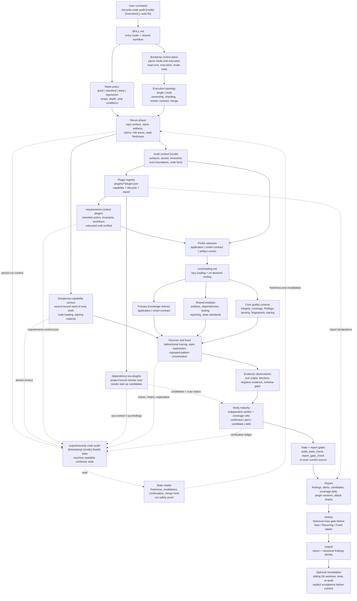

# Security Code Audit

Current release: `v4.3.0`

A code security audit skill for web/API, service, smart-contract, deployment, CI,
and instruction-bearing repositories. Chinese documentation: [README-CN.md](README-CN.md).

## Usage

- `/security-code-audit`: default `deep single` discovery
- `/security-code-audit quick`: incremental semantic review with a global dangerous-capability census
- `/security-code-audit standard`: full discovery with practical semantic depth
- `/security-code-audit deep`: stronger invariant, trust-boundary, and attack-chain closure
- `/security-code-audit regression`: retest the latest usable report
- `/security-code-audit help`: show options without starting an audit
- `/security-code-audit deep --auto-fix`: prepare isolated remediation after the audit;
  commit and merge still require separate acceptance of the reviewed changes

Optional `multi` execution requires explicit selection and host support.

## Capabilities

- Current-source discovery, bidirectional tracing, and repeated-pattern enumeration
- Immutable dangerous-capability seeds, source snapshot validation, and exact report references
- Open exploration with durable branch records and disconfirmation evidence
- Safe local execution boundaries, fresh verification, and stable coverage identity
- Application and contract authorization, state, integration, and settlement review
- Persistent audit state, report rendering, history comparison, and remediation worktrees
- Provider-independent requirement context and optional dependency-sca plugin routing after recon

Reports and state live in the running directory's `output/` using the
`security-code-audit-` prefix. See [SKILL.md](SKILL.md) for the execution contract.

## Architecture

Runtime architecture: staged scanning with mode policy, execution topology, state
freshness checks, requirement context, profile routing, lazy loading, bounded
tracing, plugin routing, evidence-gated reporting, and optional isolated remediation.
The maintainer-level breakdown lives in [ARCHITECTURE.md](ARCHITECTURE.md).

`State reader` is a conceptual operation: it summarizes prior freshness, open
obligations, and merge hints without treating them as proof.

| Path | Purpose |
| --- | --- |
| `SKILL.md` | Router, help path, shared workflow, and completion contract |
| `core/` | Integrity, coverage, findings, severity, loading, tracing, dangerous-capability census, requirement context, execution safety, remediation |
| `execution/` | `single` and beta `multi` topology, worker contracts, sharding, merge, independent verification |
| `profiles/` | Post-recon target semantics: `application`, `smart-contract`, `artifact-centric` |
| `modes/` | `quick`, `standard`, `deep`, and `regression` depth contracts |
| `references/application/` | Web/API/backend methodology, languages, frameworks, vulnerabilities, exploits |
| `references/smart-contract/` | Solidity and on-chain methodology |
| `references/shared/` | Artifacts, dependencies and SCA integration, tooling, reporting, audit state |
| `plugins/` | Provider-independent plugin contract, schema, and report presentation rules |
| `tools/` | Census seed, state and report gates, report and plugin-section renderers, remediation worktree |
| `tests/` | Contract and tool tests |

| Output | Purpose |
| --- | --- |
| `output/security-code-audit-{timestamp}-{mode}-{hash}.md` | Human-readable report |
| `output/security-code-audit-{timestamp}-{mode}-{hash}-findings.jsonl` | Canonical `finding.v1` records |
| `output/security-code-audit-{timestamp}-{mode}-{hash}-state/` | Run manifest, census, traces, function chains, evidence, verification, requirement and plugin context |

## Plugin distributions

The public distribution includes the generic [plugin framework](plugins/README.md),
schema, and metadata validator. Optional provider implementations may be bundled
in the internal distribution. An installation with no configured provider records
`not_configured` and continues the full audit.

Each plugin declares a `report` block, so its results get their own report section
(for example a full SCA dependency table) instead of being cited from other sections.
Validate installed plugin metadata with `python3 tools/audit_plugin_check.py`.
Credentials belong in user environment/configuration, outside the repository.
